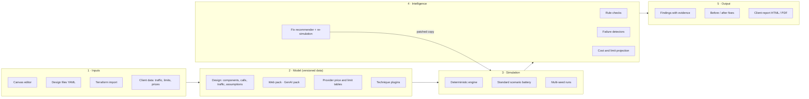

# Solution Overview

Status: v0.1 · 2026-11-25 · companion to [brd.md](brd.md) and [system-design.md](system-design.md)

This page is the short version of the whole product: what it is built with, how the pieces fit, and what the first release does. The detailed design lives in [system-design.md](system-design.md).

## Decisions taken

- **Open source, both ways.** The platform itself is open source under the MIT licence, and every dependency it ships with is open source under a licence compatible with MIT distribution. Paid or hosted services are optional add-ons, never required.
- **TypeScript everywhere**, including the simulation engine, so one codebase runs in the browser, in background workers, in the CLI and in CI.
- **Self-hosted first.** One Docker Compose install that runs entirely inside a consultancy's environment.

---

## A. Tech stack

| Layer | Choice | Licence |
| --- | --- | --- |
| Language and runtime | TypeScript on Node.js LTS | Apache-2.0 / MIT |
| Monorepo and build | pnpm workspaces, Turborepo, Vite | MIT |
| Simulation engine | Our own TypeScript core with no I/O; seeded xoshiro128** random numbers implemented in-repo | MIT (ours) |
| Schemas and validation | Zod, with JSON Schema generated from it for design files | MIT |
| Plugin rules and formulas | Common Expression Language (CEL) via `@marcbachmann/cel-js`: safe, side-effect free, not Turing-complete | MIT |
| Web app | React, React Flow (`@xyflow/react`) for the canvas, TanStack Query, Tailwind CSS | MIT |
| Charts | Apache ECharts (supports patterns, so charts do not rely on colour alone) | Apache-2.0 |
| API | Fastify with an OpenAPI description | MIT |
| Background jobs | pg-boss (job queue stored in Postgres) | MIT |
| Database and ORM | PostgreSQL, Drizzle ORM | PostgreSQL / Apache-2.0 |
| Run artifacts (time series, traces, reports) | Local disk volume behind an S3-compatible interface; SeaweedFS when a deployment needs object storage at scale | Apache-2.0 |
| PDF reports | HTML templates rendered by Playwright (headless Chromium) | Apache-2.0 |
| Login | OIDC; Keycloak bundled for self-hosted installs | Apache-2.0 |
| Narrator LLM (optional, off by default) | Provider-agnostic interface; Ollama for local models | MIT |
| Terraform input | Reads `terraform show -json` output; no Terraform dependency | n/a |
| Testing | Vitest, fast-check (property tests), Playwright (UI tests) | MIT / Apache-2.0 |
| Packaging | Docker images and Docker Compose; Helm chart later | Apache-2.0 |
| CI | GitHub Actions running unit tests, the failure benchmark suite and plugin release gates | n/a |

**Dependency licence rule.** New dependencies must be MIT, Apache-2.0, BSD, ISC or MPL-2.0. Software under GPL, AGPL, SSPL or BSL may only be used as a separately run, optional service and never linked into the product. This is why MinIO (AGPL) is not the default object store.

**Breakscale.** Breakscale is MIT licensed, so reusing its code is legally allowed with attribution. Whether to reuse it is now a technical-fit question only (ADR-01 in the system design): the current recommendation is a new core that borrows ideas, because token-carrying requests, retry policies on calls and strict determinism are easier to design in than retrofit.

---

## B. The solution at a high level

1. **Inputs.** An architect draws a design on the canvas, loads a YAML design file, or imports Terraform. Real client numbers (traffic logs, provider limits, negotiated prices) can replace defaults.
2. **Model.** Everything is data: the design graph (components, the calls between them with timeouts and retry policies, traffic classes with token sizes, and where each number came from), the web and GenAI component packs, dated provider price and limit tables, and technique plugins. Adding a component or technique never needs an engine change.
3. **Simulation.** A deterministic discrete-event engine built from eight basic parts (server with queue, multi-limit rate limiter, router, cache, autoscaler, agent loop, transform, cost). Every design runs through a standard scenario battery, each with several seeds. Quick runs happen in the browser; sweeps run on background workers.
4. **Intelligence.** Rule checks catch risky settings instantly (no timeout, no retry cap, no agent budget). Detectors read simulation results and report failures with the load and time they start at. The fix recommender tries fixes on a copy of the design and keeps only those that help without making anything else worse. Cost and limit projection names the first provider limit to be hit and the monthly bill.
5. **Output.** A findings explorer with timelines, a before/after view for each fix, and a client-ready report in which every number comes from a run.

**How it ships**

- `docker compose up` starts the web app, API, simulation workers, Postgres and Keycloak.
- A CLI runs any design file and the scenario battery without the UI, and prints findings as JSON for scripts and CI.
- The public repository holds the engine, packs, plugins and the benchmark suite of designs with known failures, so contributors can add components and techniques as data plus a test.

---

## C. Basic features (first release)

| # | Feature area | What the user can do | BRD trace |
| --- | --- | --- | --- |
| 1 | **Design** | Drag components from the web and GenAI library onto a canvas; set traffic rate and token sizes; set timeout, retry and backoff on each call; import and export YAML; keep design versions | BR-01, FR-01, FR-02 |
| 2 | **Simulate** | Run with one click; see per-component p50/p95/p99 latency, throughput, goodput, queue depth, errors, drops and cost; every run is reproducible from its seed and run ID | BR-03, FR-03 |
| 3 | **Find problems automatically** | The standard battery runs without the user choosing scenarios: load ramp to 10×, spike and recover, each dependency slowed, each node removed, provider limits squeezed, agent worst case. Findings are ranked and cover saturation, retry storms, failures that persist after a spike, cascades, single points of failure, unbounded queues, rate-limit cascades, first limit reached, retry cost storms, runaway agent loops, context growth and single-provider dependency | BR-02, FR-04, FR-05, FR-11 |
| 4 | **Evidence** | Each finding shows the scenario, the load and time it started, the failing component, a timeline chart and sample request traces, and can be re-run from its run ID | BR-03, FR-06 |
| 5 | **Proven fixes** | Suggested fixes are applied to a copy and re-run with the same seeds; the user sees before/after metrics, the exact design change and the trade-offs | BR-04, FR-07, FR-14 |
| 6 | **GenAI cost and limits** | Monthly cost at current traffic and chosen multipliers; which limit is hit first (requests, input tokens or output tokens) and at what load; cost per successful request | BR-06, FR-08–FR-10, FR-12 |
| 7 | **Assumptions** | Every parameter shows whether it is a default, client data or an estimate; the user can override it with real numbers; results show ranges where inputs are guesses | BR-09, FR-16 |
| 8 | **Client report** | Export an HTML or PDF report with summary, findings, evidence, fixes, cost and assumptions, with consultancy branding | BR-07, FR-17 |
| 9 | **Self-hosting** | Install with Docker Compose, log in with SSO, keep one workspace per client engagement; no design data leaves the environment | BR-10 |
| 10 | **CLI** | Run a design file and the battery headless and get JSON findings, for CI and scripting | BR-03 |

**Built-in fixes in the first release** (a small set, before the plugin catalog grows): exponential backoff with jitter, retry budget, circuit breaker, timeout tuning, queue limit and load shedding, read replicas, cache-aside, autoscaling policy, LLM fallback provider, prompt caching, agent step cap and budget cap.

### Later, not in the first release

| Feature | Phase (see system-design.md §16) |
| --- | --- |
| Full technique plugin format, 20–30 plugins, private plugins, benchmark release gate | Phase 2 |
| Fitting traffic and token distributions from client logs; Monte Carlo sensitivity and tornado charts | Phase 2 |
| LLM-written explanations with the evidence check | Phase 2 |
| Terraform import (AWS first) | Phase 3 |
| High-fidelity event plugins such as gossip protocols | Phase 3 |
| Combinations of fixes | Phase 3 |
| Multi-tenant hosted service and Helm chart | Phase 3 |

### Never in scope

GPU and inference-serving simulation, judging answer quality or hallucination, live production monitoring, deploying infrastructure or load-testing real systems, and security testing (BRD section 6).
