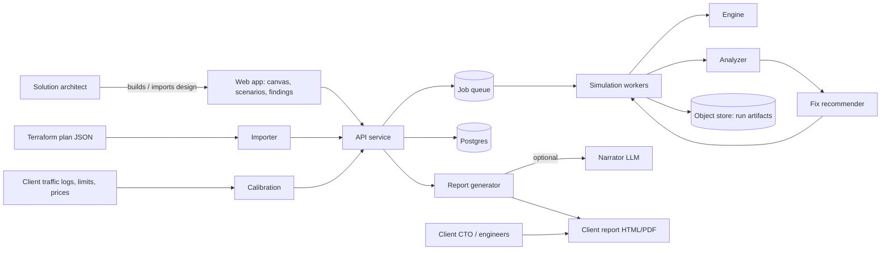
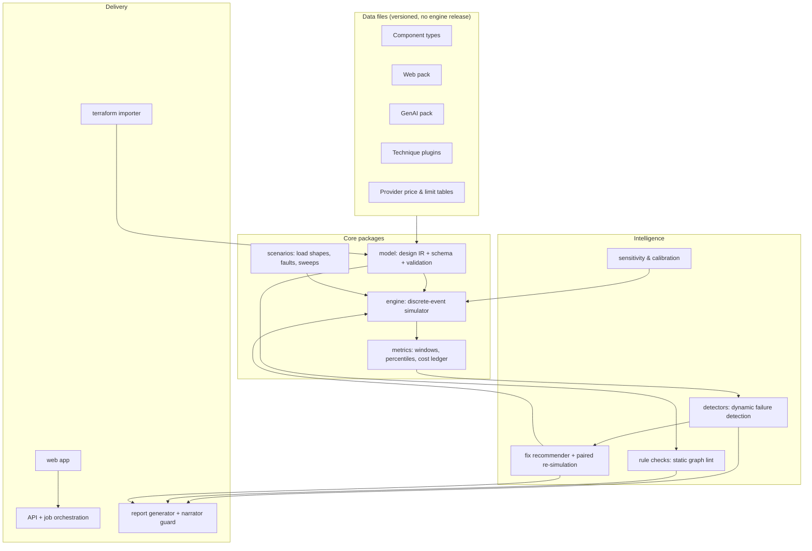

# System Design: Design-Time System Simulation Platform

Status: draft v0.2 · 2026-11-25 · derived from [brd.md](brd.md) · short version: [solution-overview.md](solution-overview.md)

This document turns the BRD into a buildable architecture: the modules, the data model, how the engine stays deterministic, how the analyzer finds failures without the user probing, how fixes are proven, and the order to build it in. Decisions are tracked in section 17; the tech stack in section 14 is final.

---

## 1. Design principles

These come straight from the BRD's non-functional requirements and decide most trade-offs below.

1. **Evidence first.** Nothing reaches a report unless a simulation run or a rule check produced it. LLMs narrate; they never diagnose (NFR "Evidence over narration").
2. **Deterministic by construction.** Same design + parameters + seed → byte-identical results. No wall clock, no `Math.random`, stable event ordering (NFR "Reproducibility").
3. **Data, not code, for domain knowledge.** Component types, domain packs and technique plugins are versioned data files. The engine only knows a small set of primitives (BR-08, NFR "Extensibility").
4. **Honest fidelity.** Every component and plugin carries a fidelity label (`formula`, `queueing`, `event`) and every guessed parameter carries a range; results show ranges, not single numbers (NFR "Honesty about fidelity").
5. **One engine, many hosts.** The same engine package runs in the browser (interactive runs), in workers (sweeps, sensitivity) and in CI (plugin benchmarks).
6. **Private by default.** Everything runs self-hosted; the LLM narrator is optional and pluggable, including a local model (BR-10).

---

## 2. System context



## 3. Module architecture



| Module | Responsibility | BRD trace |
| --- | --- | --- |
| `model` | Design intermediate representation (IR), JSON Schema, validation, versioning, diff/patch | FR-01, FR-02 |
| `engine` | Deterministic discrete-event simulation over the IR | FR-03 |
| `metrics` | Windowed time series, latency histograms, goodput, drops, per-request cost ledger | FR-03, FR-12 |
| `scenarios` | Load shapes, fault injections, parameter sweeps, standard scenario battery | FR-04 |
| `packs/web`, `packs/genai` | Component type definitions as data | FR-02, FR-08–FR-10 |
| `rules` | Static checks on the graph (missing timeout, no retry cap, no budget cap, single provider) | FR-05, FR-11 |
| `detectors` | Turn run results into findings with trigger point and evidence | FR-05, FR-06, FR-11 |
| `fixes` | Apply candidate fixes to a design copy, re-run same scenarios and seeds, accept or reject | FR-07, FR-14 |
| `plugins` | Technique plugin loader, applicability matching, benchmark harness | FR-13, FR-15 |
| `calibration` | Parameter overrides with provenance, log fitting, sensitivity ranges | FR-16 |
| `cost` | Monthly projection at current and multiplied traffic, first limit reached | FR-12 |
| `importers/terraform` | Map `terraform show -json` resources to component types | FR-18 |
| `report` | Findings → HTML/PDF; constrained LLM narration | FR-17 |
| `app` | Canvas editor, scenario editor, run viewer, findings explorer | FR-01, FR-06 |
| `server` | Projects, design versions, runs, jobs, auth, storage | BR-10 |

---

## 4. Design model (IR)

A design is a directed graph of component instances plus traffic, scenarios and parameter provenance. It is stored as JSON (authored as YAML where humans edit it) and validated by a JSON Schema published from the `model` package.

```yaml
apiVersion: sim/v1
design:
  id: support-bot
  version: 7
traffic:
  classes:
    - id: chat
      arrival: { kind: poisson, rate_rps: 40 }
      attrs:
        input_tokens:  { dist: lognormal, p50: 1200, p95: 4000 }
        output_tokens: { dist: lognormal, p50: 300,  p95: 900 }
components:
  - id: gw
    type: web/api-gateway
    params: { concurrency: 200, timeout_ms: 30000 }
  - id: agent
    type: genai/agent-loop
    params:
      steps: { dist: geometric, mean: 3 }
      loop_cap: null            # rule check flags this
      budget_cap_usd: null
  - id: llm
    type: genai/llm-provider
    params:
      provider_profile: openai/gpt-x@2026-11   # from price & limit tables
      rpm: 500
      itpm: 800000
      otpm: 160000
calls:
  - from: gw
    to: agent
    mode: sync
  - from: agent
    to: llm
    mode: sync
    per: step
    policy:
      timeout_ms: 20000
      retry: { max: 5, backoff: none, on: [429, timeout] }   # retry storm candidate
provenance:
  llm.params.itpm: { source: client, ref: "limits export 2026-11-20" }
  agent.params.steps: { source: default, range: [1, 12] }
```

Key choices:

- **Calls are first-class.** Timeouts, retries, backoff, circuit breakers, hedging and fan-out live on edges, because that is where retry storms and cascades come from.
- **Requests carry attributes.** Token counts, key (for hot keys and caches), tenant and budget ride on the request entity, so GenAI behaviour (token limits, context growth, cost) is ordinary data flow.
- **Provenance per parameter.** `default | client | estimated`, plus an optional range. This drives sensitivity runs and the assumptions section of the report.
- **Designs are immutable versions.** Fixes produce a JSON Patch against a version; the before/after pair is always two concrete versions.

## 5. Component model

The engine implements a small set of **primitives**. Component types in packs are compositions of these with defaults, so adding a component never needs an engine release.

| Primitive | Behaviour | Used by |
| --- | --- | --- |
| `station` | `c` parallel servers, service-time distribution, bounded or unbounded FIFO queue, error probability | services, DBs, embedders, rerankers |
| `limiter` | Multi-dimension token buckets (requests, input tokens, output tokens, concurrency); reject or queue on exhaustion | rate limiters, LLM provider limits |
| `router` | Round robin, least-loaded, weighted, hash/consistent-hash, priority with fallback | load balancers, LLM gateways |
| `cache` | Hit probability as function of key distribution, capacity and TTL; miss forwards | CDN, Redis, semantic cache, prompt cache |
| `scaler` | Control loop adding/removing `station` capacity with delay and cooldown | autoscalers |
| `loop` | Repeats a sub-graph per request, with step distribution, caps and state growth | agent loops |
| `transform` | Mutates request attributes (e.g. context assembly adds retrieved tokens) | prompt builder, RAG assembly |
| `cost` | Per call, per token, per GB, per instance-hour charges into the ledger | all |

Component type file (example, GenAI pack):

```yaml
kind: ComponentType
id: genai/llm-provider
version: 1.2.0
fidelity: queueing
composition:
  - limiter: { dims: [requests_per_min, input_tokens_per_min, output_tokens_per_min], on_exhaust: reject(429) }
  - station:
      concurrency: param(max_concurrency, default=inf)
      service_time: "ttft + output_tokens / output_tps"   # token-based latency
      errors: { timeout: param(timeout_rate, default=0.002), "5xx": param(error_rate, default=0.001) }
  - cost: { input_per_mtok: price(input), output_per_mtok: price(output), cached_input_per_mtok: price(cached_input) }
params:
  ttft_ms: { default: 450, range: [250, 1500] }
  output_tps: { default: 60, range: [25, 120] }
sources:
  - "provider published limits page, retrieved 2026-11-xx"
```

**GenAI pack contents (first release):** LLM provider, LLM gateway (routing, fallback, retries, semantic cache), prompt/context builder, embedding service, vector search, reranker, context assembler, agent loop, tool call, guard/eval hook (pass-through with latency, no quality modelling — out of scope).

**Web pack contents (first release):** client population, DNS/CDN, load balancer, API gateway, stateless service, cache, relational DB primary + replicas, queue/stream, worker pool, rate limiter, autoscaler, object store, external API.

Fidelity labels: `formula` (closed form, e.g. limit arithmetic, Bloom false-positive rate), `queueing` (station/limiter semantics, the default), `event` (explicit per-message events, e.g. gossip rounds).

## 6. Simulation engine

**Approach.** Process-light discrete-event simulation: a binary-heap event queue ordered by `(time, sequence)`, request entities flowing through primitives, and component state machines. No threads, no async in the core loop.

**Determinism.**
- Seeded counter-based PRNG (e.g. PCG32 or xoshiro128**), one independent stream per component and per traffic class, derived from `(run seed, component id)`. Adding a component does not shift other components' random draws, which keeps before/after comparisons fair (common random numbers).
- Simulated time only; integer microseconds to avoid float drift.
- Stable iteration order everywhere (sorted ids, no hash-map iteration order dependence).
- A run is identified by `hash(design version, pack versions, plugin versions, scenario, seed, engine version)`; this hash is printed on every finding.

**Outputs per run.**
- Time series per component per window (default 1 s): arrivals, completions, goodput, errors by kind, drops, queue length, utilization, in-flight, latency histogram (HDR-style), tokens in/out, cost.
- Request-level aggregates: attempts per originating request, fan-out, end-to-end latency, cost per successful request.
- Sampled traces (e.g. 1 in 1000 plus every request that hit a cap or exhausted retries) for timeline evidence.
- Event budget guard: runs stop with an explicit "truncated" status rather than hanging.

**Performance targets (to confirm after prototype, NFR "Interactive speed").** Order of 1–5 M events/s in a worker; an interactive run (a few minutes of simulated time at ~100 rps through ~20 components) under ~2 s in browser. Sweeps and sensitivity fan out across a worker pool.

**Language.** TypeScript for the first engine so it runs unchanged in browser, Node workers and CI. Keep the core free of I/O and allocation-heavy patterns so it can be ported to Rust→WASM later if profiling demands it (ADR-02).

## 7. Scenarios and automatic exploration

Scenarios are data: a load shape plus timed fault injections.

| Element | Options |
| --- | --- |
| Load shape | constant, ramp, step, spike (height, duration), diurnal, replay of fitted client trace |
| Faults | dependency slowdown (×factor), error-rate increase, node loss (n of m), network cut between groups, limit reduction (e.g. provider halves TPM), hot key (Zipf skew change), cache flush |
| Duration and warm-up | warm-up window excluded from metrics |

**Standard battery (how BR-02 is met).** The user does not choose what to probe. For every design the runner generates:

1. **Load ramp** from 0.5× to 10× baseline, with a binary search for the knee where p99 or goodput crosses a threshold.
2. **Spike and recover**: 3× for 60 s, then back to 1×. Detects metastable failures (retry storms that persist after the trigger is gone) — the exact case Breakscale misses.
3. **Per-dependency slowdown**: each downstream ×5 latency, one at a time.
4. **Per-node loss**: each component (or replica group) removed, one at a time → SPOF.
5. **Limit squeeze** (GenAI): each provider limit dimension at 0.5×, plus traffic with 2× longer prompts.
6. **Agent tail**: step distribution shifted to its range upper bound and tool error rate ×3.
7. **Hot key** where a cache or sharded store exists.

Each scenario runs with N seeds (default 5) so findings carry confidence intervals. The battery is the default; users can add their own scenarios.

## 8. Analyzer

Two kinds of finding producers, both emitting the same `Finding` record:

- **Rule checks** (static, instant): graph lint over the IR — sync call without timeout, retries without backoff or cap, agent loop without step or budget cap, single LLM provider with no fallback, unbounded queue, single instance on the request path. Labelled `source: rule`.
- **Detectors** (dynamic): predicates over run results. Labelled `source: simulation`.

| Detector | Signal (simplified) | Scenarios |
| --- | --- | --- |
| Saturation / knee | utilization > 0.9 and queue length slope > 0 at load L; reported as the first L where it holds | ramp |
| Unbounded queue | queue length grows without bound over window, no queue limit | ramp, spike |
| Retry amplification | attempts per originating request > threshold while goodput falls | ramp, slowdown, limit squeeze |
| Metastable failure | goodput fails to return within X% of pre-spike level after load returns to baseline | spike-and-recover |
| Cascading failure | errors/timeouts propagate upstream in time order across ≥2 hops after one fault | slowdown, node loss |
| Single point of failure | removing one component drops end-to-end goodput below threshold | node loss |
| Rate-limit cascade | 429 rate on provider → retries → higher 429 rate (positive feedback) | limit squeeze, ramp |
| First limit reached | which limit dimension (RPM/ITPM/OTPM/concurrency) exhausts first and at what load | ramp |
| Retry cost storm | cost per successful request > k × baseline | limit squeeze, slowdown |
| Runaway agent loop | step count or cost per request has unbounded tail / hits no cap; budget burn rate | agent tail |
| Context growth | input tokens per step increase monotonically within a request, approaching context limit or ITPM | agent tail |
| Single-provider dependency | provider outage → goodput to ~0 with no fallback path | node loss on provider |

`Finding` record:

```json
{
  "id": "F-0007",
  "type": "retry_amplification",
  "source": "simulation",
  "severity": "high",
  "component": "agent->llm",
  "scenario": "limit-squeeze/itpm@0.5",
  "trigger": { "load_rps": 52, "time_s": 184 },
  "metrics": { "attempts_per_request": 4.1, "goodput_drop_pct": 63, "cost_per_success_x": 3.8 },
  "confidence": { "seeds": 5, "reproduced": 5 },
  "evidence": { "run_hash": "…", "series": ["llm.429_rate", "agent.attempts", "gw.goodput"], "trace_ids": ["…"] },
  "assumptions": ["agent.params.steps default 1–12"]
}
```

Severity is computed from impact (goodput loss, latency, cost multiplier) and how near the trigger is to expected traffic (a knee at 1.2× baseline outranks one at 8×).

## 9. Fix recommendation and proof

1. **Candidate generation.** Each finding type maps to fix templates and to technique plugins whose applicability rule matches (e.g. retry amplification → exponential backoff with jitter, retry budget, circuit breaker; first limit reached → request batching, prompt caching, second provider, limit increase request; runaway loop → step cap, budget cap).
2. **Apply** as a JSON Patch to a copy of the design version.
3. **Re-simulate** the *same* scenarios with the *same* seeds (common random numbers), so differences come from the fix, not noise.
4. **Accept** only if: the target finding no longer triggers (or its trigger load moves out by a stated factor), and no KPI regresses beyond tolerance in any battery scenario, and no new finding appears (FR-14).
5. **Rank** by improvement per unit of added cost/complexity; list the plugin's declared trade-offs.
6. **Report** before/after metrics and the patch itself, so engineers can see exactly what changed.

Fixes are searched greedily one at a time in the first release; combinations are a later enhancement.

## 10. Technique plugins

A plugin is a data package: manifest, behaviour model, applicability rule, patch template, validation check, trade-offs, and a benchmark.

```yaml
kind: Technique
id: bloom-filter-negative-lookup
version: 0.3.0
fidelity: formula
addresses: [saturation]
applies_when: >
  exists component c where c.type in ["web/relational-db","web/kv-store"]
  and traffic.miss_ratio(c) > 0.3
patch:
  insert_before: "{c}"
  component: { type: technique/bloom-filter, params: { bits_per_key: 10 } }
behavior:
  false_positive_rate: "exp(-(bits_per_key * ln(2)^2))"
  short_circuit: "negative lookups return without calling {c}, except false positives"
tradeoffs:
  - "Memory: bits_per_key × keys"
  - "Deletes need a counting variant or periodic rebuild"
valid_ranges: { bits_per_key: [4, 20] }
sources: ["Bloom 1970; standard FPR approximation"]
benchmark:
  design: benchmarks/bloom/db-heavy-misses.yaml
  scenario: ramp-0.5-to-5x
  expect: { "db.utilization@3x": { change: "-40%", tolerance: "10%" } }
```

- **Expression language.** Applicability rules and behaviour formulas use a small, sandboxed, side-effect-free expression language (CEL-like), not arbitrary code. An escape hatch for `event`-fidelity plugins (e.g. gossip) is a TypeScript module implementing a narrow primitive interface, reviewed like engine code.
- **Release gate (FR-15).** CI loads every plugin, runs its benchmark, and fails the release if the measured effect is outside tolerance.
- **Private plugins.** A consultancy can mount its own plugin directory; private plugins follow the same benchmark rule.
- **Starter catalog (20–30, to confirm):** backoff + jitter, retry budget, circuit breaker, bulkhead, timeout tuning, hedged requests, load shedding, queue limit, cache-aside, request coalescing, read replicas, sharding with consistent hashing, Bloom filter, autoscaling policy, CDN, async queue offload, LLM fallback provider, semantic cache, prompt caching, request batching, model routing (small/large), token budget per request, agent step cap, context truncation/summarization, rate-limit-aware client, gossip membership (event fidelity).

## 11. Cost, calibration and sensitivity

**Cost (FR-12).** Every call writes to a cost ledger (per component, per traffic class). Monthly projection = simulated cost rate × traffic calendar at 1× and user-chosen multipliers (e.g. 2×, 5×, 10×), with ranges from sensitivity. Provider price and limit tables are versioned data with retrieval date and source; reports cite the version used. "First limit reached" is computed both analytically (fast, from token distributions) and confirmed by the ramp simulation.

**Calibration (FR-16, BR-09).**
- Override any parameter with provenance `client`.
- Fit arrival rates, diurnal shape and token distributions from client logs (CSV/JSON of timestamp + token counts); fitting runs locally, raw logs are not stored by default.
- Import provider limit exports and negotiated prices.

**Sensitivity.** For every parameter whose provenance is `default` or `estimated` and that has a range, run one-at-a-time sweeps (cheap) and Latin-hypercube Monte Carlo (thorough, background). Findings and cost projections then show ranges (p10–p90), and the report includes a tornado chart of which assumptions move the result most — telling the client which real number would most improve accuracy.

## 12. Terraform import (FR-18)

- Input: `terraform show -json` plan/state output (not raw HCL), so modules and variables are already resolved.
- Mapping table (data): resource type → component type + parameter extraction rules, e.g. `aws_lb` → `web/load-balancer`, `aws_db_instance` → `web/relational-db` (instance class → default concurrency and service time), `aws_sqs_queue` → `web/queue`, `aws_elasticache_*` → `web/cache`, `aws_lambda_function` → `web/stateless-service` with concurrency limit.
- Call edges are inferred where possible (security groups, target groups, env vars referencing endpoints) and otherwise left for the user to draw; the importer reports unmapped resources and inferred edges with a confidence label.
- AWS first; Azure and GCP mapping tables added as data.

## 13. Reports and the narrator guard (FR-17)

- Report is rendered from structured data (findings, fixes, cost, assumptions, sensitivity) through templates to HTML and PDF, with consultancy branding.
- Every number in the report is inserted by the template from run data, never written by an LLM.
- Optional LLM narration: the model receives the findings JSON and may write explanations that reference finding ids (`[F-0007]`). A validator rejects narration that mentions a component, failure type or number not present in the referenced findings, and rejects any paragraph without a finding reference. If validation fails, the report falls back to template text.
- Charts use shape and pattern as well as colour (NFR "Accessibility").
- Each finding links to its reproducible run hash; an appendix lists assumptions, parameter provenance, fidelity labels and plugin sources (NFR "Auditability").

## 14. Platform, deployment and tech stack

Final stack. The platform is MIT-licensed open source and every shipped dependency is permissively licensed (ADR-07). Licences are listed in [solution-overview.md](solution-overview.md#a-tech-stack).

| Layer | Decision | Why |
| --- | --- | --- |
| Monorepo | pnpm workspaces + Turborepo + Vite | Shared engine across browser, worker and CI |
| Engine, model, detectors | TypeScript, pure, no I/O; in-repo PCG32 PRNG; Zod schemas → JSON Schema | Runs everywhere; portable to Rust/WASM later |
| Plugin expressions | CEL via `@marcbachmann/cel-js` | Sandboxed, non-Turing-complete, MIT |
| Web app | React + React Flow (`@xyflow/react`) + TanStack Query + Tailwind; Apache ECharts with pattern fills | Mature canvas editing; accessible charts |
| API | Fastify, OpenAPI | Same language as engine; simple ops |
| Jobs | pg-boss on Postgres; dedicated broker only if needed | Fewer moving parts for self-hosting |
| Workers | Node worker threads in containers; horizontal scale | Sweeps are embarrassingly parallel |
| Storage | Postgres + Drizzle ORM (projects, design versions, findings); local disk behind an S3-compatible interface for run series, traces and reports; SeaweedFS at scale | Avoids AGPL MinIO |
| Reports | HTML templates + Playwright (headless Chromium) for PDF | One rendering path |
| Narrator | Provider-agnostic interface; Ollama for local models; off by default | Privacy (BR-10) |
| Deployment | Docker Compose for single-tenant self-hosted; Helm chart later; optional managed cloud | NFR "Privacy" |
| Auth | OIDC/SSO with bundled Keycloak; workspace per engagement; audit log of runs and report exports | Consultancy client separation |
| Testing and CI | Vitest, fast-check, Playwright; GitHub Actions runs benchmark suite and plugin gates | Section 15 |

Proposed repository layout:

```
apps/
  web/                 canvas, scenario editor, run viewer, findings
  server/              API, job orchestration, auth
  worker/              simulation + analysis worker
  cli/                 run designs and plugin benchmarks headless (also used in CI)
packages/
  model/               IR types, JSON Schema, validation, patching
  engine/              discrete-event core and primitives
  metrics/
  scenarios/
  rules/
  detectors/
  fixes/
  plugins/             loader, expression language, benchmark harness
  calibration/
  cost/
  importers/terraform/
  report/
packs/
  web/                 component type data files
  genai/
  providers/           price and limit tables (dated)
techniques/            technique plugins + their benchmark designs
benchmarks/            seeded failure-mode suite (BRD success metric 1)
docs/
  brd.md
  system-design.md
  adr/
```

## 15. Quality and validation strategy

- **Seeded failure benchmark suite.** A library of designs with known, labelled failure modes (retry storm, metastable spike, rate-limit cascade, runaway agent, SPOF, hot key, unbounded queue, context growth, …). The analyzer runs on all of them in CI; this measures the BRD's "≥90% detected" and "<10% false findings" targets.
- **Engine correctness.** Property tests against closed-form queueing results (M/M/1, M/M/c, Erlang-C waiting time, Little's law on every run), token bucket arithmetic, and determinism tests (same hash → identical output, across browser and Node).
- **Golden runs.** Snapshot outputs for reference designs; any engine change that shifts them needs an explicit, reviewed update.
- **Plugin benchmarks** as release gates (section 10).
- **Reviewer feedback loop.** Reviewers can mark a finding "rejected: false/unsupported"; this feeds the false-finding metric and detector threshold tuning.

## 16. Delivery plan

The BRD's roadmap figure was not included in the markdown export, so this is a proposed phasing. Phases are ordered, not dated, each ending in a gate.

| Phase | Scope | Exit gate |
| --- | --- | --- |
| **0. Proof prototype** | CLI only. IR + engine (station, limiter, router, loop) + 6 GenAI/web component types + spike/ramp/limit-squeeze scenarios + 4 detectors (retry amplification, metastable, rate-limit cascade, runaway loop) + JSON findings. | Detects a retry storm, a provider rate-limit cascade and a runaway agent loop on the benchmark designs **without manual probing**, deterministically (BRD next step 2). |
| **1. MVP for one consultancy** | Canvas editor, full web + GenAI packs, standard scenario battery, all detectors, rule checks, fix recommender with paired re-simulation, cost projection, HTML/PDF report (no LLM), Docker Compose self-host. | Used on 2–3 real reviews; first findings in < 30 min; reviewer rejection rate measured. |
| **2. Extensibility and calibration** | Technique plugin format + 20–30 starter plugins with benchmarks, calibration from logs, sensitivity ranges, guarded LLM narration. | All plugins pass benchmarks; reports show ranges and assumptions; ≥90% detection on benchmark suite. |
| **3. Import and scale-out** | Terraform import (AWS first), event-fidelity plugins (gossip), fix combinations, multi-tenant managed option, Helm. | Import maps ≥80% of resources on sample client plans; decision on product vs internal tool made. |

Workstreams that can run in parallel within Phase 1: engine + detectors; canvas app; GenAI pack + provider tables; report generator.

## 17. Architecture decisions to record (ADRs)

| ADR | Decision | Status and outcome | Needed by |
| --- | --- | --- | --- |
| ADR-01 | Build on Breakscale's engine or write new core | **Open.** Breakscale is MIT licensed (2026-11-25), so reuse is legally fine with attribution; the remaining question is technical fit. Recommended: write a new, small core and borrow ideas, because determinism, token-carrying requests and edge policies are cheaper to design in than retrofit. Decide after reading its engine code. | Before Phase 0 |
| ADR-02 | Engine language | **Decided:** TypeScript; Rust→WASM only if profiling shows the need | Before Phase 0 |
| ADR-03 | Expression language for plugins | **Decided:** CEL via `@marcbachmann/cel-js` (MIT); code escape hatch only for `event` fidelity | Phase 2 |
| ADR-04 | Deployment model at launch | **Decided:** self-hosted Docker Compose first | Phase 1 |
| ADR-05 | First LLM providers covered | **Open.** Recommended: two or three major hosted providers + one OpenAI-compatible gateway profile | Phase 0 |
| ADR-06 | Detector thresholds | **Open.** Recommended: data-driven per detector, tuned on the benchmark suite, shown in the report | Phase 1 |
| ADR-07 | Licence and dependency policy | **Decided:** product is MIT open source; shipped dependencies must be MIT, Apache-2.0, BSD, ISC or MPL-2.0; GPL/AGPL/SSPL/BSL only as separately run optional services | Now |

## 18. Risks specific to the design

| Risk | Mitigation in this design |
| --- | --- |
| Detectors are noisy and erode trust | Multi-seed confirmation, benchmark suite with false-finding metric, reviewer rejection loop |
| Standard battery is too slow for interactive use | Analytic pre-screen (formula fidelity) first, then simulate only promising regions; knee search by bisection; parallel workers |
| Default parameters dominate results | Provenance + ranges on every parameter, sensitivity tornado, calibration hooks |
| Fix acceptance flips with noise | Common random numbers, multiple seeds, tolerance bands |
| Plugin authors write wrong models | Benchmark gate, valid ranges, cited sources, fidelity labels |
| Agent behaviour is hard to model | Treat steps and tool error rates as explicit distributions with wide ranges; label as `estimated`; show sensitivity |

## 19. Traceability

| BR | Covered by sections |
| --- | --- |
| BR-01 Evaluate before build | 4, 5, 6, 12 |
| BR-02 Find failures on its own | 7, 8 |
| BR-03 Evidence and reproducibility | 6 (determinism, run hash), 8 (Finding record), 13 |
| BR-04 Tested fixes | 9 |
| BR-05 Web + GenAI in one model | 4, 5 |
| BR-06 GenAI cost, limits, loop risk | 5, 8, 11 |
| BR-07 Client-ready report | 13 |
| BR-08 Techniques without engine change | 5, 10 |
| BR-09 Real client data | 11, 12 |
| BR-10 Stays in consultancy environment | 1, 14 |
